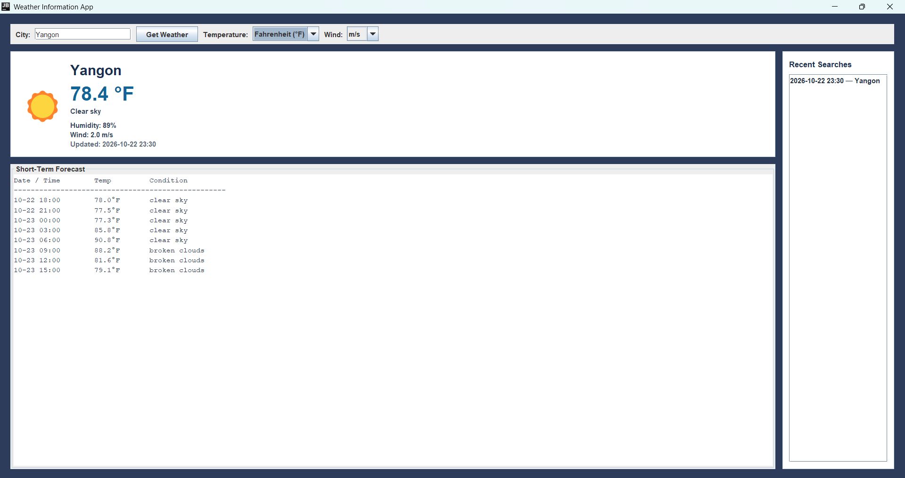

# Weather Information App

## Overview
A Java Swing desktop application that retrieves current weather and a short-term forecast using the OpenWeatherMap API.

## Sample


## Features
- Search by city name
- Current temperature, weather condition, humidity, and wind speed
- Weather emoji icons
- Forecast for the next eight 3-hour periods
- Celsius/Fahrenheit and m/s, km/h, or mph selection
- Recent searches with timestamps (up to 10 entries)
- Input validation and API/network error messages
- Background color changes according to the computer's local time

## Requirements
- JDK 17 or newer
- Internet connection
- OpenWeatherMap API key
- The `org.json` library (included at `lib/json-20250517.jar`)

The app addresses the assignment requirements with a Swing interface, city search, current weather details, weather icons, a short-term forecast, temperature and wind unit selection, input and API error handling, timestamped recent searches, and a background that changes by local time of day.

## Setup and run
1. Create an account at https://openweathermap.org/ and obtain an API key.
2. Open `src/main/java/WeatherInformationApp.java`.
3. Set the `API_KEY` constant to your own OpenWeatherMap key. Do not commit or share the key.
4. Open PowerShell in the project folder and compile:
   ```powershell
   javac -cp "lib\json-20250517.jar" -d out src\main\java\WeatherInformationApp.java
   ```
5. Run the application:
   ```powershell
   java -cp "out;lib\json-20250517.jar" WeatherInformationApp
   ```

Maven is also supported through the included `pom.xml`. The first activation of a new API key may take some time. Keep the key private and do not upload it publicly.

## Implementation notes
- Java Swing creates the graphical interface.
- Java's built-in `HttpClient` sends HTTP requests.
- The `org.json` library parses the API responses.
- `SwingWorker` performs network requests away from the GUI event thread.
- Search history is stored in memory and is cleared when the application closes.
- Forecast data is shown in approximately 24 hours of 3-hour periods.
- The background reflects local computer time, not the searched city's time.

## Screenshot for submission
The image above is the supplied sample at `src/Img/sample.png`. For submission evidence, run the program, search for a valid city, and take your own screenshot showing the current weather and forecast. Insert that screenshot into your Word/PDF report.
